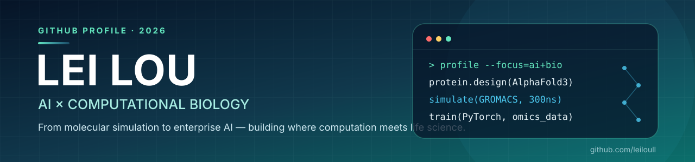
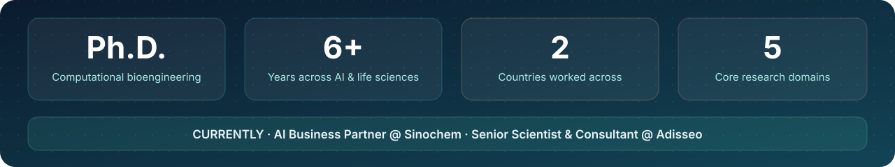

  
    
  

  <h1>Lei Lou</h1>

  
<b>Ph.D. Computational Bioengineer</b> AI for life sciences · protein design · drug discovery

  
📍 Beijing / Nanjing, China

  

    
    
    
    
  

  

> 💡 **In short:** I turn complex biological data into models, decisions, and products — from protein design and molecular simulation to enterprise AI strategy.

## 🧠 What I work on

| | |
|---|---|
| 🤖 **AI for life sciences** | Enterprise AI roadmaps, LLM adoption, predictive analytics, data-centric R&D decisions |
| 🧬 **Protein & peptide design** | AlphaFold2/3, RoseTTA, docking, molecular dynamics, virtual screening |
| 📊 **Bioinformatics & omics** | Sequencing, Scanpy, disease-associated SNPs, gene expression, binding-site prediction |
| ⚙️ **Scientific machine learning** | PyTorch, TensorFlow, scikit-learn, algorithm optimization on HPC |
| 🧪 **Lab ↔ computation** | NGS, RNAi, Cryo-EM, HPLC/NMR, assay development, microfluidics |

### Toolkit

  <b>Languages & data</b> 
  
  
  
  
  
  

  <b>AI / ML</b> 
  
  
  
  

  <b>Biology & simulation</b> 
  
  
  
  
  

  <b>Infrastructure</b> 
  
  
  
  
  
  

## 🚀 Experience

| Period | Role | Focus |
|---|---|---|
| **2026 – Now** | **AI Business Partner**, Sinochem | Enterprise AI strategy, LLM adoption, cross-functional team building |
| **2026 – Now** | **Senior Scientist & Consultant**, Adisseo | AI/ML for animal nutrition, predictive modeling, R&D transformation |
| **2023 – 2025** | **Senior Computational Scientist & PM**, Innatrix | Protein/peptide design, antibody platform, 4+ initiatives from 100K+ datapoints |
| **2023 – 2024** | **Tutor**, WholeRen Education | STEM mentorship in chemistry, biology, genetics, immunology |
| **2021 – 2022** | **TA & Lab Assistant**, University of Georgia | 20+ lab lectures, bioinformatics tools, PCR & chromatography |
| **2020 – 2021** | **Engineering Intern**, LifeReal Biotech | Computational biology and lab workflow support |

<b>More on the current roles</b>

**AI Business Partner — Sinochem** · Beijing · Mar 2026 – Present

- Lead enterprise-wide AI planning and execution, aligning digital transformation with life-science and materials business goals.
- Build a cross-functional AI team, define key roles, and create partnerships with leading technology vendors.
- Turn stakeholder problems into AI roadmaps, championing LLMs and predictive analytics for data-centric decisions.

**Senior Scientist & Scientific Consultant — Adisseo** · Nanjing · Apr 2026 – Present

- Apply ML and predictive modeling to animal nutrition R&D, improving enzyme performance optimization.
- Design and validate models that accelerate discovery of novel feed-additive formulations.
- Integrate AI tools into experimental workflows and connect internal teams with external partners.

## 🎓 Education & credentials

| | |
|---|---|
| 🎓 **Ph.D., ECE** | University of Georgia · 2017–2022 — neurodegenerative disease simulation and energy metabolism control |
| 🎓 **B.Eng., Bioengineering** | Chongqing University of Technology · 2013–2017 |
| 📜 **Certifications** | Machine Learning (DeepLearning.AI & Stanford) · Google Project Management · Drug Discovery (UCSD) |

## 📫 Let's connect

  
  
  
  

---

  Thanks for stopping by — feel free to reach out if you work at the intersection of AI, biology, or drug discovery.

